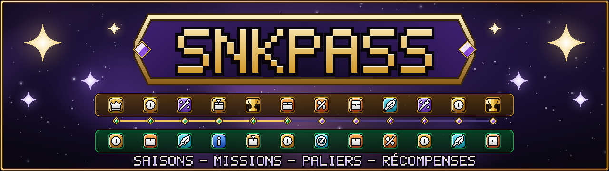
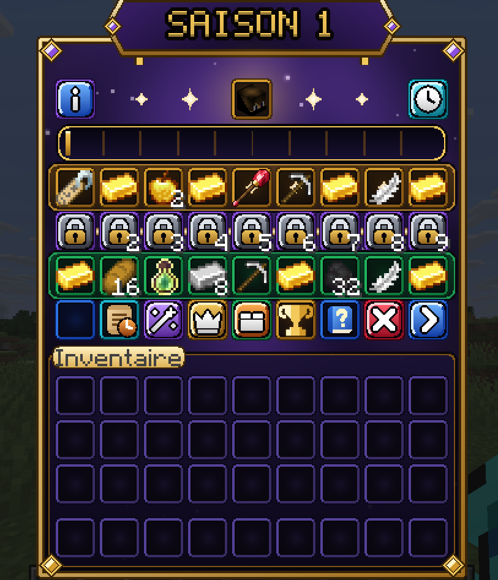

<b>Un pass de saison : des missions, 50 paliers et des récompenses, avec une piste gratuite et une piste Or.</b> 
Plugin Minecraft pour serveurs <b>Paper 1.21.4 à 26.3</b>, par <b>SnkAlex</b>.

<a href="#-fonctions">Fonctions</a> •
<a href="#-les-récompenses">Récompenses</a> •
<a href="#-captures">Captures</a> •
<a href="#-commandes">Commandes</a> •
<a href="#-compatibilité">Compatibilité</a> •
<a href="#-lobtenir">L'obtenir</a>

---

## ✨ Fonctions

### 🎖️ Des saisons
- Une saison dure **30 jours** (réglable), avec son nom et son compte à rebours
- **50 paliers** et **2 pistes** : une gratuite pour tous, une Or avec plus de récompenses
- À la fin : **les 3 premiers sont récompensés**, tout repart à zéro, et les récompenses oubliées sont **gardées**, même pour les joueurs absents

### 📜 Des missions
- **3 par jour, 5 par semaine et 3 par saison**, les mêmes pour tout le serveur
- 16 genres : miner, couper, récolter, combattre, pêcher, fabriquer, cuire, élever, enchanter, marcher, échanger avec les villageois, voter...
- De l'XP aussi avec les **votes** et le temps de jeu
- Toutes les missions se changent dans un fichier

### 🖱️ Un menu en frise
- Les paliers défilent de gauche à droite : on voit tout de suite ce qui est pris, à prendre ou verrouillé
- Un bouton **« Tout réclamer »**
- Une récompense impossible (inventaire plein, pas de clan...) **attend** au lieu d'être perdue

### 🌈 Des cosmétiques
Titres et couleurs dans le chat, particules en marchant. Ils sont **gardés d'une saison à l'autre**.

### 🛡️ Contre la triche
Les blocs posés, les monstres de spawner, le mode créatif et les joueurs immobiles ne comptent pas. Une récompense ne peut jamais être prise deux fois.

### ⚖️ La piste Or
Elle s'achète avec **l'argent du jeu**. Un mode **« cosmétique seulement »** permet de la proposer autrement en respectant les règles de Mojang, qui interdisent de vendre un avantage en jeu.

---

## 🎁 Les récompenses

| Genre | Exemple | Plugin |
|---|---|---|
| Argent, objets, niveaux | 500 $, 6 diamants, 5 niveaux | — |
| Titre, couleur, particules | « Légende » | — |
| Commande | Tout ce que tu veux | — |
| Outils en gemme | Pioche en rubis | [SnkGemmes](https://github.com/SnkStudio/SnkGemmes) |
| XP de métier | 300 XP | [SnkMetiers](https://github.com/SnkStudio/SnkMetiers) |
| XP de clan, temps de vol | 10 min de vol | [SnkClans](https://github.com/SnkStudio/SnkClans) |
| Bon de réduction | −10 % au `/shop` pendant 24 h | [SnkMarche](https://github.com/SnkStudio/SnkMarche) |
| Place de boutique | +1 boutique | [SnkBoutiques](https://github.com/SnkStudio/SnkBoutiques) |

**Le pass marche aussi tout seul :** si un plugin n'est pas installé, sa récompense est remplacée et ses missions ne sont pas tirées.

---

## 📸 Captures

 La frise : piste Or en haut, paliers au milieu, piste gratuite en bas

---

## ⌨️ Commandes

| Commande | Effet |
|---|---|
| `/pass` (ou `/battlepass`, `/bp`) | La frise des paliers |
| `/pass missions` | Les missions |
| `/pass cosmetiques` | Titre, couleur et particules |
| `/pass classement` | Les meilleurs de la saison |
| `/pass or` | La piste Or |
| `/pass reclamer` | Prend toutes les récompenses |
| `/pass admin xp <joueur> <n>` · `or <joueur>` · `vote <joueur>` | Donner de l'XP, la piste Or, compter un vote (admin) |
| `/pass admin saison [suivante]` · `reload` | Gérer la saison, recharger (admin) |

**Permission :** `snkpass.admin`.

<b>Placeholders (PlaceholderAPI)</b>

`%snkpass_palier%` `%snkpass_xp%` `%snkpass_titre%` `%snkpass_or%` `%snkpass_saison%`

---

## 🧩 Compatibilité

| | |
|---|---|
| **Versions** | 1.21.4 à 26.3, un seul fichier pour toutes |
| **Testé sur** | Paper 1.21.4, 1.21.11, 26.2 et 26.3 |
| **Serveur** | Paper |
| **Java** | 21 ou plus (celui de ta version de Paper) |
| **Conseillé** | Vault et une économie |
| **Facultatif** | Votifier / NuVotifier, PlaceholderAPI et les autres plugins Snk |

---

## 📦 Ce que tu reçois
- Le plugin (`.jar`)
- Le pack de ressources des menus
- Le guide d'installation et le guide complet, en français

Aucune connaissance en code n'est nécessaire : tout se règle dans trois fichiers.

---

## 📩 L'obtenir

Le plugin n'est pas en téléchargement libre. Pour le prix, une question ou une démonstration :

➡️ **[Écris-moi ici](../../issues/new/choose)** (il faut un compte GitHub, c'est gratuit)

> Les messages sont **publics** : n'écris ni adresse e-mail, ni mot de passe, ni information de paiement. On passe ensuite en privé.

---

© SnkAlex. Tous droits réservés. Voir <a href="LICENSE.md">la licence</a>. 
Ce plugin n'est pas un produit officiel Minecraft. Il n'est ni approuvé par Mojang ou Microsoft, ni associé à eux.

